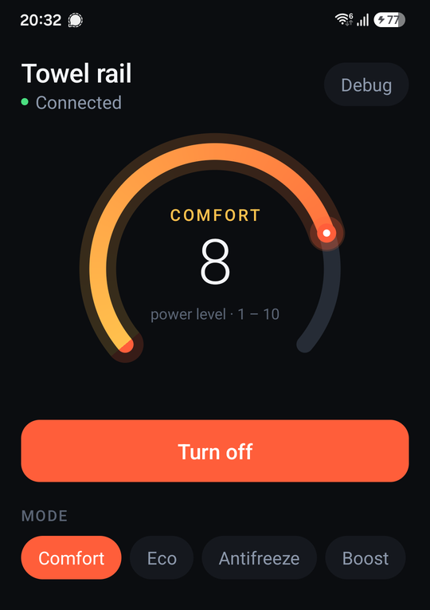
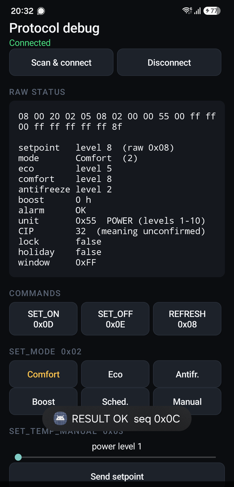

# irca-ble-protocol

Reverse-engineered BLE protocol for **IRCA / Zoppas** electric heaters and towel
rails — the ones sold under names like **Olle** (Somatherm) and controlled by the
*Olle Connect* Android app — plus a clean-room Python implementation.

The goal is to make these devices usable from Home Assistant, `bleak`, or
anything else that speaks Bluetooth LE, instead of only from the vendor app.

> **Not affiliated with** IRCA S.p.A., Zoppas Industries, Sysdata, Somatherm, or
> any related company. No vendor code, binaries, or assets are distributed here.

<p align="center">
  
</p>

<p align="center">
  <em>The included Android app — 37 KB, plain Java, no Gradle. The dial adapts
  to whichever unit family the heater reports: power levels 1–10 here,
  real degrees on a Celsius or Fahrenheit unit.</em>
</p>

---

## What's here

| Path | What it is |
|---|---|
| [`docs/OLLE_BLE_PROTOCOL.md`](docs/OLLE_BLE_PROTOCOL.md) | **The protocol specification.** GATT map, 20-byte frame format, full opcode table, status layout, auth analysis, verification log. |
| [`androidapp/`](androidapp/) | **A working Android app** that controls the heater. Plain Java, no Gradle, no AndroidX — builds to a 37 KB APK in about five seconds. |
| [`docs/BUILDING_AN_INTEGRATION.md`](docs/BUILDING_AN_INTEGRATION.md) | How to turn the spec into a Home Assistant integration or standalone app. Entity modelling, connection management, publishing checklist. |
| `scripts/olle_protocol.py` | Dependency-free protocol library: frame building, checksums, status/result parsing. |
| `scripts/test_protocol.py` | 62 offline assertions, including real captured frames as regressions. No hardware needed. |
| `scripts/olle_ctl.py` | `bleak` CLI — connect, read status, send commands. |
| `scripts/olle_scan.py` | Find the device and dump its GATT table. |
| `scripts/probe_status.py` | Strictly read-only probe (writes nothing). |
| `scripts/get_snoop.py` | Extracts Android's **btsnooz** log from `dumpsys bluetooth_manager` and converts it to btsnoop. Generally useful for Android BLE RE. |
| `scripts/decode_btsnoop.py` | btsnoop → HCI → L2CAP → ATT decoder that annotates this protocol. |

## Quick start

```bash
pip install bleak

python scripts/olle_scan.py                  # find it (advertises as "Olle")
python scripts/olle_scan.py --addr <ADDR> --enumerate
python scripts/probe_status.py <ADDR>        # read-only: nothing is written
python scripts/olle_ctl.py --addr <ADDR> --no-auth status
```

Run the test suite without any hardware:

```bash
cd scripts && python test_protocol.py
```

### The Android app

A self-contained controller app: circular setpoint dial, on/off, mode
selection, and a debug screen showing every frame in and out.

```bash
cd androidapp
./build.sh            # aapt2 -> javac -> d8 -> zipalign -> apksigner
./build.sh install    # ...and adb install -r
```

It needs only the Android SDK build-tools and a JDK — **no Gradle, no Android
Studio, no AndroidX**. The whole app is ~1,500 lines of plain Java and the
resulting APK is 37 KB. `FACTORY_RESET` is deliberately not implemented
anywhere in it.

The **Debug** button in the header opens a raw protocol view: the live `STATUS`
frame in hex, every field decoded, direct command buttons labelled with their
opcodes, and a running log of each frame in and out. It is how most of the
verification in [spec §12](docs/OLLE_BLE_PROTOCOL.md#12-verification-log) gets
reproduced.

<p align="center">
  
</p>

## The protocol in one screen

Primary service `35ba1523-94f5-9052-4cd4-f102b6580adf`. Write 20-byte frames to
`…1525` (CMD); listen on `…1524` (STATUS) and `…1526` (RESULT).

```
 offset  0        1        2 .............. 18       19
        +--------+--------+------------------------+----------+
        | opcode |  seq   |  payload, 0xFF-padded  | checksum |
        +--------+--------+------------------------+----------+

checksum = XOR of bytes 0..18        # that is the entire integrity scheme
```

Responses are `[status][opcode echo][seq echo][payload…]`, where status `0x04`
means success.

Full details, including the opcode table and the three different temperature
encodings, are in [the spec](docs/OLLE_BLE_PROTOCOL.md).

## ⚠ Security: these heaters have no access control

Verified on firmware 3.2.0: a client that **never authenticates** can connect
without pairing or bonding, read all state, and write commands that the device
accepts and executes. There is no encryption, no bonding requirement, and no
replay protection. The `AUTH_DEVICE` command the app sends is a 16-character
string transmitted in cleartext on every connection, and the firmware does not
appear to require it.

In practice: **anyone within Bluetooth range can control one of these heaters.**

That is a property of the product, not of this project — it is true whether or
not this repository exists. It is documented here so owners can make an informed
decision about the device, and because it is the reason this integration does
*not* need you to extract a credential from your phone.

See [spec §5.1](docs/OLLE_BLE_PROTOCOL.md#51-authentication-is-not-actually-enforced).

## Status

Hardware-verified against one **Olle** towel rail (firmware 3.2.0, POWER
variant):

- ✅ GATT map, characteristic properties, advertising behaviour
- ✅ 20-byte frame format and XOR checksum (6 real frames)
- ✅ `STATUS` decode — matched the app's own defaults exactly
- ✅ `RESULT` layout (this **corrected** what the vendor app's own code implies)
- ✅ `SET_ON` / `SET_OFF` round-trip — accepted, executed, and reflected in
  `STATUS`, **with no authentication sent at any point**
- ✅ `REFRESH_STATUS` write accepted with no authentication
- ⚠️ Setpoint and mode writes (`0x02`, `0x03`) are exercised by the Android app
  but have not been separately verified frame-by-frame.
- ⚠️ The Celsius `×10 − 70` codec is derived from two independent places in the
  app but has never been seen on real hardware — the test unit uses abstract
  power levels 1–10 instead.
- ❌ Multipart transfers (statistics, schedules, diagnostics) not analysed.

Per-item confidence is tracked in [spec §9](docs/OLLE_BLE_PROTOCOL.md#9-verification-status).

## Contributing

The most valuable contributions right now:

1. **A capture from a Celsius or Fahrenheit unit** — run `probe_status.py` and
   paste the `STATUS` frame. This would confirm the temperature codec.
2. **Confirmation that `SET_ON`/`SET_OFF` work**, on any unit.
3. **Other IRCA/Zoppas devices.** The same app ships build configurators for
   `Deltacalor` and `StoneBLE`, so the stack likely covers more hardware.

Please **never** include a real `device_id`, BLE address, or serial number in an
issue — redact them.

## Method & legality

Produced by analysing an application installed on the device owner's own phone,
in order to interoperate with hardware they own. Decompilation for
interoperability is permitted in the EU under Article 6 of Directive 2009/24/EC
(Sweden: 26 g § URL 1960:729).

This repository contains **only** the protocol description and an independent
implementation written from it. The vendor's APK and decompiled sources are
excluded by `.gitignore` and are not redistributed.

## License

[MIT](LICENSE)
